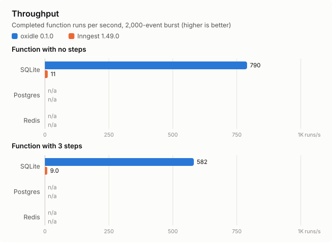
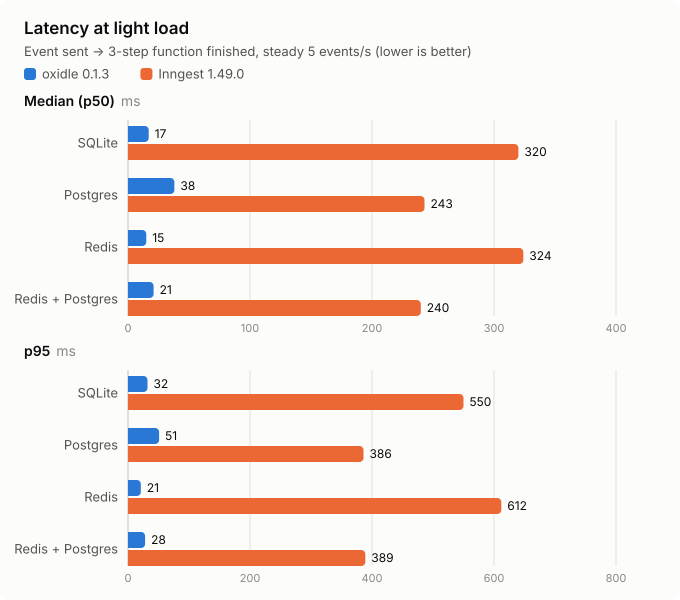

# Benchmarks

oxidle compared with the official self-hosted Inngest server (`inngest start`) on each
storage backend, using the same SDK app, the same workload and the same Docker network.





## Results

<!-- results:start -->
Medians of 3 repetitions. Throughput runs send 2,000 events in batches of 200.

### Throughput (runs/s, higher is better)

| Backend | Function | oxidle 0.1.0 | Inngest 1.49.0 | oxidle advantage |
|---|---|--:|--:|--:|
| SQLite | no steps | 790 | 10 | **79×** |
| SQLite | 3 steps | 582 | 8 | **73×** |
| Postgres | no steps | 1,110 | 294 | **3.8×** |
| Postgres | 3 steps | 696 | 202 | **3.4×** |
| Redis | no steps | 1,921 | 10 | **192×** |
| Redis | 3 steps | 1,010 | 9 | **112×** |

### Latency at light load (ms, lower is better)

Event sent → last step of a 3-step function finished, 100 events sent one at a time at a steady rate (so p99 is the slowest run).

| Backend | Server | p50 | p95 | p99 |
|---|---|--:|--:|--:|
| SQLite | oxidle 0.1.0 | 18 | 29 | 41 |
| SQLite | Inngest 1.49.0 | 325 | 507 | 689 |
| Postgres | oxidle 0.1.0 | 37 | 49 | 55 |
| Postgres | Inngest 1.49.0 | 239 | 394 | 416 |
| Redis | oxidle 0.1.0 | 15 | 22 | 26 |
| Redis | Inngest 1.49.0 | 304 | 493 | 707 |

### Resource use

CPU is the total CPU time spent by the server container plus the database container (Postgres/Redis), divided by runs completed, during the 3-step throughput run. Memory is the server container's peak anonymous (heap) memory; it excludes the database container.

| Backend | Server | CPU per run (ms) | Peak server memory (MB) |
|---|---|--:|--:|
| SQLite | oxidle 0.1.0 | 1.53 | 49 |
| SQLite | Inngest 1.49.0 | 38.18 | 378 |
| Postgres | oxidle 0.1.0 | 4.81 | 44 |
| Postgres | Inngest 1.49.0 | 31.91 | 320 |
| Redis | oxidle 0.1.0 | 0.80 | 44 |
| Redis | Inngest 1.49.0 | 26.59 | 326 |
<!-- results:end -->

## What is measured

Every run uses the e2e test app (`e2e/app`, Inngest JS SDK v4 on Express, Node 22) and two
functions:

- **no steps**: `bench-1` returns immediately (one SDK request per run).
- **3 steps**: `bench-3` runs three sequential `step.run` calls and returns (four SDK requests per
  run, since the SDK reports each step back to the server).

Three measurements per configuration:

- **Throughput**: 2,000 events sent in batches of 200 as fast as possible. The measurement is the
  time from the first send to the last run completing, as seen by the app.
- **Latency**: 100 events sent one at a time at 5 events/s, a rate both servers keep up with.
  Each event carries its send time, and the app records how long after that the function's last
  step finished. Latency is measured in its own session on a freshly started server, so it is not
  affected by backlog left over from the throughput bursts.
- **Resources**: CPU time read from each container's cgroup (`cpu.stat`) before and after a run,
  and the server's peak anonymous memory (`memory.stat`) sampled every second across both sessions.

A 200-event warm-up runs first and is not recorded. Each measurement is repeated three times and
the median is reported.

## What the backends mean

The servers split storage differently, so the same flag means slightly different things:

| `BACKEND` | oxidle | Inngest |
|---|---|---|
| `sqlite` | everything in SQLite (`--sqlite-dir`) | history in SQLite; queue and run state in its built-in in-memory Redis |
| `postgres` | everything in Postgres (`--postgres-uri`) | history in Postgres; queue and run state in its built-in in-memory Redis |
| `redis` | queue and run state in Redis (`--redis-uri`); history in SQLite | queue and run state in Redis (`--redis-uri`); history in SQLite |

Both servers otherwise run with default settings. Postgres 16 and Redis 7 run in their own
containers and are counted in the CPU figures.

## Environment

- Apple M4 (10 cores), 24 GB RAM, macOS 27.0.1
- OrbStack (Docker 29.8.2, Linux 7.2.9 arm64 VM)
- `inngest/inngest:v1.49.0` (arm64 image) and oxidle 0.1.0 built from `./Dockerfile` (release profile)
- Postgres `postgres:16-alpine`, Redis `redis:7-alpine`, app on `node:22-alpine`
- No CPU or memory limits on containers. The server, database, SDK app and load generator all share
  the same machine, so absolute numbers include the cost of the app itself; the comparison is
  between servers under identical conditions.

## About the Inngest numbers

**SQLite is Inngest's bottleneck.** On the SQLite and Redis rows Inngest manages about 10 runs/s;
on Postgres it reaches about 300. The Redis row is slow too because `--redis-uri` only moves the
queue and run state: Inngest still writes history and traces to SQLite. Under load its logs fill
with `error inserting span` / `error inserting trace run` errors (`context canceled`, tens of
thousands per session) and `critical section took longer than boundary` warnings, where scheduling
a single event took up to several seconds while waiting on SQLite. oxidle writes run timelines
through a batched background writer rather than on the execution path, which is part of why its
SQLite numbers stay close to the other backends.

Before finding that, these settings were tried on the SQLite configuration (300–500 event bursts,
no-steps function); none of them help, because none of them touch the SQLite writes:

| Inngest configuration (SQLite) | runs/s |
|---|--:|
| defaults (v1.49.0) | 11 |
| `--tick 10` (poll the queue every 10 ms instead of 150 ms) | 7–10 |
| `--queue-workers 1000` (default 100) | 7–20 |
| `EXPERIMENTAL_KEY_QUEUES_ENABLE=true` | 11 |
| v1.30.0 | 13 |
| v1.11.13 | 10 |

**Postgres needs a bigger idle pool.** With the default `--postgres-max-idle-conns 10` (of 100
open), Inngest keeps opening and closing Postgres connections under load until the container runs
out of local ports (`connect: cannot assign requested address`); that caused one slow repetition
(34 runs/s) in the results above. Raising the idle pool fixes it. The same flag, given to both
servers (2 repetitions each):

| `--postgres-max-idle-conns 100` | no steps | 3 steps |
|---|--:|--:|
| oxidle 0.1.0 | 1,151–1,266 | 646–708 |
| Inngest 1.49.0 | 523–524 | 376–390 |

So on a tuned Postgres setup oxidle is roughly 2× faster; on the defaults, and on any setup that
keeps SQLite, the gap is much larger. Memory is a consistent difference either way: Inngest's
server holds 320–380 MB at peak, oxidle under 50 MB.

These are numbers for the single-node self-hosted server. Inngest Cloud is a different,
horizontally scaled deployment and is not measured here.

## Reproduce

```sh
./bench/matrix.sh                             # full matrix, about an hour (Inngest dominates)
TARGETS=oxidle BACKENDS=redis REPS=1 ./bench/matrix.sh   # a single cell
python3 bench/report.py bench/results/<file>.jsonl     # regenerate charts + the tables above
```

Knobs: `N` (events per throughput run), `REPS`, `RATE` / `DURATION` (latency run),
`INNGEST_IMAGE`, `SERVER_ARGS` (extra flags for both servers), `SPECS` (sessions separated by
`|`, each on a fresh server; default `"throughput:one throughput:three|latency:three"`). The raw results behind this page are in
`bench/results/matrix.jsonl`; each run also saves the server logs next to its results file
(`<name>-<target>-<backend>-<session>.log`, not committed).

For a quicker check against a server running on the host, `BENCH=1 ./e2e/run.sh` runs the same
throughput workload through the e2e harness.
